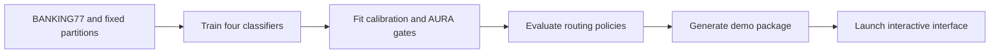

# AURA

**Cost-aware selective routing for BANKING77 intent classification.**

**Team:** Puspita Chowdhury and Farhat Jahan.

AURA studies whether accounting for the consequences of an incorrect intent route
can improve the trade-off between automation and deferral to human review. It
compares Logistic Regression, Random Forest, DistilBERT and Ettin, then applies
calibrated routing policies to the two encoder models.

The complete workflow runs through Python on a capable local or remote machine.
Colab is optional. Training generates the demo package; the interface loads that
package for predictions and result comparisons.



## 1. Install

Run commands from the repository's `AURA` directory. Use Python **3.12 or 3.13**
and create a virtual environment inside it:

```bash
python3.12 -m venv venv
source venv/bin/activate
python -m pip install --upgrade pip
python -m pip install -r requirements.txt
python -m pip install -e .
```

On Windows, activate the environment with `venv\Scripts\activate` instead.
If the environment is already prepared, activate it and continue below.

Installation provides the Python libraries and research package. Trained weights
are created by training or supplied by an existing model package.

## 2. Train and generate a package

This path requires no notebook, Google Drive connection or downloaded AURA export.
Initial BANKING77 and pretrained base-model downloads need internet unless the
files are already available locally.

First validate the configuration and fixed data partitions without loading or
training models:

```bash
python train_aura.py --download-data --check-only
```

Then run the complete pipeline on a machine with suitable computing resources:

```bash
python train_aura.py \
  --download-data \
  --device auto \
  --run-dir artifacts/training/native-v1 \
  --package artifacts/demo_packages/native-v1 \
  --include-test \
  --activate
```

The command:

1. Validates BANKING77 labels, content and the fixed development partitions.
2. Trains TF-IDF + Logistic Regression, TF-IDF + SVD + Random Forest, DistilBERT
   and Ettin-150M on the same model-training partition.
3. Fits the lexical witness on training rows and each encoder's temperature and
   correctness gates on calibration rows.
4. Evaluates classification, calibration, nine routing policies and guard controls.
5. Writes checkpoints and results, generates a verified demo package, and selects
   it in `config/local_demo.json` after successful export.

Settings are in [config/training.json](config/training.json). Defaults retain
**7,002 training / 1,500 calibration / 1,501 validation** examples, five epochs per
encoder, and maximum sequence length 128. New runs produce their own results;
they do not replace archived experiments.

| Option | Purpose |
|---|---|
| `--device auto` | Select CUDA, then MPS, then CPU. Explicit devices are also supported. |
| `--download-data` | Download missing BANKING77 CSVs from the official repository. |
| `--check-only` | Validate inputs without model loading or training. |
| `--include-test` | Also evaluate the previously exposed official test set. Omit for validation-only results. |
| `--epochs N` | Explicitly change both encoder training budgets for a new experiment. |
| `--resume` | Reuse completed model stages when inputs, configuration and hashes match. |
| `--local-files-only` | Load pretrained base models only from local paths or the Hugging Face cache. |
| `--zip` | Also create a ZIP of the generated package. |
| `--activate` | Select the generated package for the demo after export succeeds. |

Resume works between completed model stages, not inside an interrupted encoder
epoch. Choose a new package destination for re-exporting; existing packages are
never overwritten. Bootstrap and exploratory cost-learning experiments have
separate runners under `scripts/experiments/`.

## 3. Run the demo

After training with `--activate`, verify and launch the selected package:

```bash
python aura_demo_package.py --inspect
python aura_demo_package.py
```

Inspection should report `"ready": true` and `"integrity_verified": true`.
Open **http://127.0.0.1:7860**. Keep the terminal running; use **Ctrl+C** to stop.

The launcher performs inference using saved models. It does not start training.
Once dependencies and a complete package are available, prediction requires no
internet or training dataset. CPU inference is the default.

To use a package without changing the saved configuration:

```bash
python aura_demo_package.py --package artifacts/demo_packages/native-v1
```

### Reuse an existing package

A previously trained export, including one created in Colab, uses the same format.
Extract its complete ZIP under `artifacts/demo_packages/` and either pass its path
with `--package` or set [config/local_demo.json](config/local_demo.json):

```json
{
  "package_directory": "artifacts/demo_packages/aura-demo"
}
```

Keep the extracted folder intact: its model weights, tokenizers, temperatures,
gates, validation scores and results belong together. Generated packages and
downloaded packages are both supported by the same launcher.

### Interface

- **Live routing:** choose Ettin or DistilBERT, enter a banking-support message,
  and compare confidence, signed lexical gate and **Cost-aware gate** decisions.
  Expand the explanation for probabilities and the routing calculation.
- **Experimental results:** select the encoder, partition, cost scenario and
  automation target. Graphs show classification performance, automated errors
  and routing costs from that package's saved run.

## Configuration and dependencies

| File | Role |
|---|---|
| [requirements.txt](requirements.txt) | Maintained runtime dependencies; install from the repository root. |
| [pyproject.toml](pyproject.toml) | Research package installation and development tools; historical configuration remains frozen. |
| [config/training.json](config/training.json) | Data paths, fixed partitions and model training settings. |
| [config/local_demo.json](config/local_demo.json) | Package selected by the demo launcher. |
| [config/intent_workflows.yaml](config/intent_workflows.yaml) | Intent workflows and consequence flags. |
| [config/consequence_scenarios.yaml](config/consequence_scenarios.yaml) | Flat, moderate and high-protection cost assumptions. |

The requirements file **inside an export** records its standalone installation
profile. When working from this repository, use the root requirements file. When
using only an extracted ZIP, follow its `START_HERE.md`. Leave files inside an
export unchanged because its manifest verifies their integrity. A different
export may require a separate compatible environment for its fitted sklearn gates.

## Repository layout

```text
AURA/
├── train_aura.py                 # native training and package generation
├── aura_demo_package.py          # package export, verification and local loading
├── aura_demo_ui.py               # interactive interface
├── requirements.txt
├── pyproject.toml
├── config/                      # training, package selection and cost definitions
├── src/aura/                    # reusable research code
│   └── pipeline/                # native data, encoder training and orchestration
├── scripts/                     # individual research entry points
│   └── experiments/             # exploratory research runners
├── notebooks/                   # optional Colab training and download workflows
├── tools/                       # developer verification and download helpers
├── tests/                       # unit and integration checks
├── data/splits/                 # fixed development split manifest
├── reports/                     # retained research records
└── artifacts/                   # local generated files, excluded from Git
    ├── training/<run>/          # checkpoints, provenance and evaluation results
    ├── demo_packages/<package>/ # complete packages consumed by the interface
    ├── downloads/               # original downloaded ZIPs
    └── exploratory/             # saved exploratory experiments
```

Dataset CSVs are stored in `datasets/` and excluded from Git. Model weights and
results stay under `artifacts/`. Launch from the repository root to use the
maintained interface code; copies inside exported packages are portable snapshots.

## Optional Colab workflows

- [AURA_Colab_Demo.ipynb](notebooks/AURA_Colab_Demo.ipynb): training, evaluation
  and export. Section 3 loads the accompanying
  [aura_project_spec.json](notebooks/aura_project_spec.json). Section 13 contains
  one current-run routing results explorer; section 15 opens the interface;
  section 16B exports the prepared models and results. The notebook starts without
  saved outputs. Leave `SHOW_DIAGNOSTICS = False` for the compact flow, or enable
  it for detailed stage tables, feature inspections and pilot diagnostics.
- [AURA_Download_Saved_Export.ipynb](notebooks/AURA_Download_Saved_Export.ipynb):
  retrieve an existing Drive export without retraining.

Colab exports are saved under `MyDrive/AURA_Colab_Demo/exports/`. They are an
alternative way to obtain a package, not a prerequisite for native Python training.

## Development checks

With the runtime installed, add the development tools:

```bash
python -m pip install -e '.[dev]'
ruff check .
ruff format --check .
python -m mypy src scripts tests aura_demo_ui.py aura_demo_package.py train_aura.py
python -m pytest
```

Install Git hooks once with `pre-commit install`. Run them manually with
`pre-commit run --all-files`. The native integration check uses synthetic data
and tiny trainable encoders; it verifies the workflow without repeating full
BANKING77 training. Historical protocol paths and archived results are retained.

## Troubleshooting

| Issue | Action |
|---|---|
| Port 7860 is occupied | Use `python aura_demo_package.py --port 7861`. |
| `No module named aura` | Activate the intended environment and run `python -m pip install -e .`. |
| Missing library | Install the repository's root `requirements.txt` in the active environment. |
| Missing dataset | Add `--download-data` to the training or validation command. |
| Missing/incomplete package | Run `python aura_demo_package.py --inspect`, then finish training or restore the complete export. |
| Package hash mismatch | Restore the original affected file or re-extract the complete ZIP; keep the manifest intact. |
| sklearn version mismatch | Use an environment compatible with the selected package's fitted artifacts. |
| Existing run/package directory | Resume an interrupted compatible run or choose fresh output names. |

## Research scope

The main research policy is the **Cost-aware gate**. Workflows and numerical costs
are relative research assumptions, not measured banking losses. AURA is not a
uniform winner across every model and automation target. Live-query thresholds
come from validation data and do not guarantee the same automation rate on new
messages. Previously exposed official-test results are not fresh confirmatory
evidence. The prototype does not execute transactions or send review notifications.

## Run these commands in your terminal:
- cd /Users/farhatjahan/Desktop/YU/YU4/AURA
- source venv/bin/activate
- python aura_demo_package.py

Then open http://127.0.0.1:7860 in your browser.